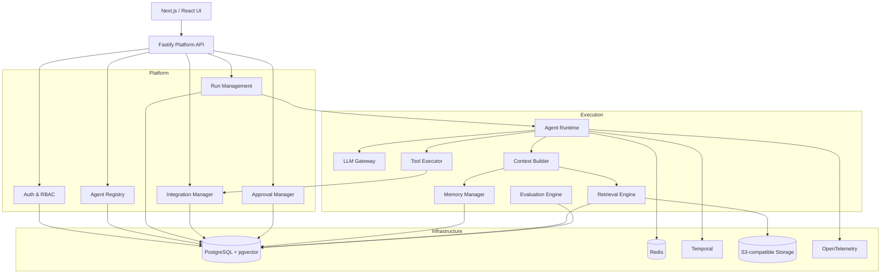
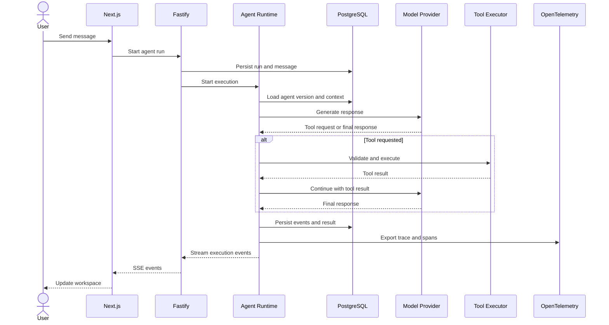

# Workforce — Project Specification

**Documento:** Product, Architecture & Implementation Specification  
**Projeto:** Workforce (working name)  
**Categoria:** AI Engineering Platform / Agent Operations Workspace  
**Objetivo:** construir um projeto de portfólio que demonstre domínio prático de AI Engineering, arquitetura de sistemas e operação de aplicações baseadas em LLMs.

> O objetivo não é criar apenas uma interface para conversar com agentes. O Workforce deve permitir definir, executar, integrar, observar, avaliar e melhorar agentes e workflows de IA.

---

# 1. Visão do produto

Workforce é uma plataforma para desenvolver e operar agentes de IA conectados a ferramentas, fontes de conhecimento e workflows.

A plataforma oferece um ambiente único para:
- Criar e configurar agentes.
- Conversar com agentes e acompanhar execuções.
- Conectar ferramentas e sistemas externos.
- Gerenciar contexto e memória.
- Construir pipelines RAG.
- Orquestrar workflows duráveis.
- Exigir aprovação humana para ações sensíveis.
- Inspecionar traces, spans, logs e custos.
- Avaliar qualidade e comparar versões de agentes.

## 1.1 Objetivo de aprendizagem

O projeto deve funcionar como laboratório prático de AI Engineering. O foco é compreender fluxos, responsabilidades e trade-offs, não apenas produzir código.

Ao final, deve ser possível demonstrar:
1. Como um LLM recebe contexto e produz respostas.
2. Como funciona o ciclo de execução de um agente.
3. Como o modelo solicita ferramentas e como o backend as executa com segurança.
4. Como gerenciar histórico, contexto e memória.
5. Como construir e avaliar um pipeline RAG.
6. Como executar workflows com estado durável, retries e aprovações.
7. Como instrumentar e depurar execuções.
8. Como avaliar sistematicamente a qualidade de agentes.
9. Como proteger dados, ferramentas, credenciais e operações.
10. Como projetar uma arquitetura extensível sem complexidade prematura.

## 1.2 Princípios

- **Engineering-first:** privilegiar conceitos e capacidades de AI Engineering.
- **Observable by design:** toda execução relevante deve ser rastreável.
- **Explicit control:** o modelo não é autoridade de autorização.
- **Modular architecture:** separar responsabilidades sem começar com microservices.
- **Provider-agnostic where useful:** permitir trocar providers sem apagar diferenças importantes.
- **Build to understand:** implementar fundamentos antes de delegar tudo a frameworks.
- **Progressive complexity:** adicionar componentes quando existir necessidade concreta.

---

# 2. Escopo funcional

## 2.1 Módulos

| Módulo | Responsabilidade | Prioridade |
|---|---|---|
| Home | Resumo operacional e itens que exigem atenção | P0 |
| Activity | Histórico de execuções e eventos | P0 |
| Agents | Diretório e workspaces de agentes | P0 |
| Agent Settings | Configuração completa de cada agente | P0 |
| Workflows | Definição e execução de processos | P0 |
| Integrations | Conexões, ferramentas e provedores | P0 |
| Knowledge | Ingestão de documentos e RAG | P0 |
| Traces | Inspeção de traces, spans e execuções | P0 |
| Evaluations | Datasets, scorers e experimentos | P0 |
| Settings | Administração do workspace | P1 |
| Analytics | Métricas agregadas de uso, qualidade e custo | P1 |

P0 representa o núcleo necessário para demonstrar a proposta técnica. P1 representa capacidades complementares.

## 2.2 Sidebar e navegação

A sidebar deve seguir uma estrutura de workspace simples, inspirada na referência visual escolhida.

```text
WORKFORCE
┌──────────────────────────────────┐
│ Workspace selector               │
│ Acme Corporation                  │
├──────────────────────────────────┤
│ Search                           │
├──────────────────────────────────┤
│ Home                             │
│ Activity                         │
│ Workflows                        │
│ Integrations                     │
├──────────────────────────────────┤
│ DRAFTS                       [+] │
│  New agent                       │
├──────────────────────────────────┤
│ AGENTS                       [+] │
│  Finance Assistant               │
│  Support Triage                  │
│  Contract Reviewer                │
│  Invoice Intake                   │
├──────────────────────────────────┤
│ ENGINEERING                      │
│  Knowledge                       │
│  Traces                           │
│  Evaluations                     │
├──────────────────────────────────┤
│ Settings                         │
│ User profile                     │
└──────────────────────────────────┘
```

Regras:
- Agentes são entidades de primeira classe e aparecem diretamente na sidebar.
- Selecionar um agente abre seu workspace de conversa.
- O ícone de configurações no workspace abre a configuração completa do agente.
- Drafts contém agentes ainda não publicados.
- O botão `+` em Agents inicia a criação de um agente.
- O diretório completo pode ser acessado por `View all`.
- Não duplicar a navegação com uma seção administrativa de agentes que repita a lista.
- A sidebar deve ter scroll independente para a lista de agentes.
- Status discretos: active, running, waiting approval, error, paused/draft.
- Settings é para administração do workspace; não deve esconder ferramentas de engenharia.

## 2.3 Home

A Home deve ser um centro operacional enxuto, não um dashboard de BI.

Deve responder:
1. O que está acontecendo?
2. O que precisa de atenção?
3. Como chegar rapidamente à execução relevante?

Conteúdo:
- Resumo de execuções recentes.
- Falhas que precisam de investigação.
- Aprovações pendentes.
- Agentes com problemas.
- Indicadores compactos: runs, success rate e latency.
- Links para traces e activity.

Evitar saudações dominantes, cards enormes para cada agente, gráficos sem ação associada, métricas repetidas e dados fictícios apresentados como reais.

## 2.4 Activity

Centro de histórico operacional:
- Lista de agent runs e workflow runs.
- Filtros por agente, workflow, status e período.
- Identificador, status, duração, horário e custo quando disponível.
- Link para abrir o trace completo.
- Indicação de execução aguardando aprovação.
- Detalhe de eventos e resultado final.

## 2.5 Agents

### Diretório
- Lista de agentes, pesquisa e filtros.
- Estado de publicação e execução.
- Modelo configurado e última execução.
- Acesso ao workspace.
- Ações: duplicate, pause, resume e archive.

### Agent Workspace

O workspace prioriza a conversa. Layout:
1. Sidebar global.
2. Área central de conversa.
3. Painel contextual opcional de Activity / execution details.

Header: nome e identidade do agente, status, versão publicada, ícone de settings e menu de ações.

A conversa deve suportar histórico, streaming, estados de execução, tool calls como eventos, aprovações pendentes, falhas, tentativas e links para traces.

Não exibir chain-of-thought privado. Exibir eventos, ações, argumentos e resultados seguros e autorizados para inspeção.

### Agent Settings

A engrenagem abre uma área dedicada, mantendo a navegação global.

| Seção | Conteúdo |
|---|---|
| General | Nome, descrição, função, identidade e status |
| Instructions | System instructions, templates e comportamento |
| Model | Provider, modelo, parâmetros, limites e fallback |
| Tools | Ferramentas disponíveis e operações permitidas |
| Connections | Conexões autenticadas com sistemas externos |
| Knowledge | Coleções e fontes disponíveis |
| Memory | Escopo, leitura, escrita e retenção |
| Permissions | Autonomia, limites e aprovações |
| Advanced | Timeout, retries e opções do runtime |
| Versions | Histórico, comparação e rollback |

Manter separados:
- Connection: acesso autenticado a um sistema.
- Tool: operação que pode ser executada nesse sistema.
- Agent permission: autorização para um agente utilizar determinada operação.

## 2.6 Workflows

Editor visual para processos compostos por etapas determinísticas e chamadas de agentes.

Nodes previstos:
- Trigger.
- Agent.
- Tool.
- Condition.
- Transform.
- Approval.
- Delay.
- HTTP request.
- End.

Capacidades:
- Canvas com zoom e pan.
- Conexões entre nodes.
- Configuração e validação de nodes.
- Retry e timeout por etapa.
- Tratamento de erros.
- Histórico de versões.
- Inspeção de execução específica.

Separar Builder Mode de Run Inspection Mode. A edição do workflow não deve ser misturada com a inspeção de uma execução.

## 2.7 Integrations

Gerenciamento de provedores, conexões e ferramentas.

Categorias futuras: CRM, ERP, Productivity, Communication, Databases, Storage, Custom APIs e MCP Servers.

Funcionalidades:
- Catálogo de integrações.
- Criar e revogar conexões.
- Gerenciar credenciais de forma segura.
- Descobrir ferramentas disponíveis.
- Associar ferramentas a agentes.
- Configurar permissões.
- Inspecionar erros e estado de conexão.

## 2.8 Knowledge

Módulo para ingestão, indexação, recuperação e avaliação de fontes:
- Upload de documentos.
- Sources e collections.
- Parsing e extração.
- Chunking.
- Embeddings.
- Indexação vetorial.
- Metadata filters.
- Retrieval Playground.
- Visualização de chunks recuperados.
- Reranking, quando implementado.
- Histórico de ingestão e erros.

## 2.9 Traces

Módulo de observabilidade:
- Trace Explorer.
- Filtros por agente, workflow, status, modelo e período.
- Árvore hierárquica de spans.
- Timeline/waterfall.
- Inputs e outputs autorizados.
- LLM calls, tool calls e retrieval calls.
- Duração por etapa.
- Tokens e custo estimado.
- Erros e retries.
- Correlação com agent version, workflow run e logs.

Conceitos:
- Trace: uma execução completa.
- Span: uma operação dentro da execução.
- Logs: eventos e mensagens registrados.
- Metrics: valores agregados como latência e taxa de erro.

## 2.10 Evaluations

Módulo para medir qualidade e detectar regressões:
- Evaluation datasets.
- Test cases e expected outputs.
- Deterministic evaluators.
- LLM-as-a-judge.
- Human review.
- Experiments.
- Comparação de versões e modelos.
- Histórico de resultados.

Métricas possíveis: correctness, relevance, faithfulness, tool selection accuracy, tool argument correctness, retrieval quality, instruction following, safety, latency e cost.

## 2.11 Settings

Administração do workspace:
- Workspace profile.
- Members and roles.
- Security policies.
- Audit log.
- Data retention.
- Secrets management.
- Preferências pessoais.

Não implementar todos os recursos enterprise na primeira versão.

---

# 3. Arquitetura técnica

## 3.1 Estilo arquitetural

Começar com um **modular monolith**, acompanhado de workers separados para tarefas assíncronas.

Não iniciar com microservices por módulo. A separação lógica deve permitir extração futura, mas a implantação deve continuar simples enquanto o sistema for pequeno.

## 3.2 Camadas

### Experience Layer
Next.js, React, TypeScript, chat e streaming, agent workspace, workflow builder, traces e evaluations.

### Platform Layer
API, autenticação e autorização, multi-tenancy, agent registry, agent versions, conversations, runs, tool registry, connections, approvals e workspace administration.

### AI Execution Layer
LLM Gateway, Agent Runtime, Context Builder, Tool Executor, Memory Manager, Retrieval Engine e Evaluation Engine.

### Infrastructure & Data Layer
PostgreSQL, pgvector, Redis, Object Storage, Temporal e OpenTelemetry.

## 3.3 Diagrama lógico



As caixas representam responsabilidades lógicas, não necessariamente serviços independentes.

## 3.4 Fluxo de execução de agente



A execução não pode depender da conexão HTTP permanecer aberta. O estado e os eventos devem ser persistidos para suportar desconexões do navegador.

---

# 4. Tecnologias

## 4.1 Stack principal

| Camada | Tecnologia | Motivo |
|---|---|---|
| Frontend | Next.js + React | Interface e roteamento |
| Linguagem | TypeScript | Tipagem e contratos |
| UI | Tailwind CSS + shadcn/ui | Design system |
| Data fetching | TanStack Query | Cache e estado remoto |
| Local state | Zustand | Estado local compartilhado |
| Forms | React Hook Form + Zod | Formulários e validação |
| API | Node.js + Fastify | Backend principal |
| ORM | Drizzle ORM | Acesso tipado ao PostgreSQL |
| Validation | Zod | Contratos e schemas |
| Logs | Pino | Logs estruturados |
| Database | PostgreSQL | Persistência relacional |
| Vector search | pgvector | Embeddings e retrieval |
| Cache | Redis | Cache e coordenação temporária |
| Object storage | S3-compatible / R2 | Documentos e artefatos |
| Durable workflows | Temporal | Execução durável |
| Observability | OpenTelemetry | Traces, metrics e propagação |
| Testing | Vitest + Playwright | Testes unitários e E2E |
| Monorepo | pnpm + Turborepo | Organização de código |
| Local infrastructure | Docker Compose | Ambiente local |

## 4.2 Node.js e Python

### Node.js / TypeScript — plataforma principal

Usar para API, domínio, Agent Runtime inicial, LLM Gateway, Tool Registry, Tool Executor, Context Builder, integrações e streaming.

### Python / FastAPI — serviços especializados, se necessário

Usar futuramente para parsing documental especializado, OCR, experimentos de ML, pipelines especializados de avaliação ou bibliotecas de IA que tragam vantagem concreta.

Não criar um serviço Python apenas para fazer chamadas de LLM. Começar com TypeScript e introduzir Python quando existir necessidade técnica clara.

## 4.3 LLM providers

Começar com um provider e adicionar um segundo para estudar diferenças de APIs e capacidades.

Abstração sugerida:

```ts
interface ModelProvider {
  generate(input: ModelRequest): Promise<ModelResponse>;
  stream(input: ModelRequest): AsyncIterable<ModelEvent>;
  getCapabilities(): ModelCapabilities;
}
```

A abstração deve preservar diferenças importantes entre modelos. Não assumir que todos suportam os mesmos parâmetros, structured outputs, ferramentas ou modalidades.

## 4.4 Agent Runtime

Implementar inicialmente o agent loop manualmente.

Estudar frameworks como LangGraph depois de compreender agent loop, estado, tool calling, context management, handoffs, limites e condições de parada.

O runtime deve ser compartilhado por várias definições de agentes. Um agente é configuração e estado, não um processo de software independente.

## 4.5 Temporal

Usar para workflows duráveis e processos que precisam esperar por aprovação, retomar após interrupções, executar retries, sobreviver a reinicializações e controlar timeouts.

O Agent Runtime executa o ciclo de raciocínio. Temporal orquestra processos duráveis. São responsabilidades complementares.

---

# 5. Persistência e modelo de dados

## 5.1 PostgreSQL

Banco principal e source of truth.

Entidades iniciais:

| Entidade | Responsabilidade |
|---|---|
| organizations | Organizações |
| users | Usuários |
| memberships | Usuários e organizações |
| agents | Definições de agentes |
| agent_versions | Versões imutáveis |
| conversations | Conversas |
| messages | Mensagens |
| agent_runs | Execuções |
| run_events | Eventos de execução |
| tool_definitions | Definições de ferramentas |
| tool_executions | Execuções de ferramentas |
| connections | Conexões externas |
| workflows | Definições de workflows |
| workflow_versions | Versões de workflows |
| workflow_runs | Execuções de workflows |
| approvals | Aprovações |
| knowledge_sources | Fontes de conhecimento |
| documents | Documentos |
| document_chunks | Chunks processados |
| evaluation_datasets | Datasets |
| evaluation_cases | Casos de teste |
| evaluation_runs | Experimentos |

## 5.2 pgvector

Usar inicialmente como extensão do PostgreSQL para armazenar embeddings, buscar por similaridade, aplicar filtros por metadata e experimentar vector search e hybrid search.

Não introduzir um vector database separado sem evidência de necessidade.

## 5.3 Redis

Usar para rate limiting, cache, locks e coordenação, estado efêmero de streaming quando necessário e pub/sub quando aplicável.

Não usar Redis como source of truth de execuções ou dados que precisam de persistência durável.

## 5.4 Object Storage

Armazenar documentos originais, PDFs e DOCX, arquivos enviados, artefatos de avaliação e arquivos gerados.

PostgreSQL armazena metadados e referências aos objetos, não os binários em geral.

## 5.5 Regras de persistência

- Entidades de negócio devem ter escopo de organização/workspace quando aplicável.
- Dados de tenants diferentes devem ser isolados.
- Agent definitions e published versions devem ser separadas.
- Agent run e workflow run devem ser entidades distintas.
- Eventos de execução devem ser persistidos.
- Credenciais devem ser armazenadas por mecanismo seguro, nunca em texto puro ou em prompts.
- Logs e traces devem aplicar redaction de dados sensíveis.

---

# 6. Observability e tracing

## 6.1 OpenTelemetry

Instrumentar requisições HTTP, agent runs, LLM calls, tool calls, retrieval, workflow activities, erros e retries.

## 6.2 Modelo de trace

```text
Trace: Finance Assistant
│
├── Agent initialization
├── Context assembly
├── LLM call
├── Tool call: search_invoice
├── LLM call
├── Tool call: match_purchase_order
└── Approval requested
```

Cada operação relevante deve gerar spans correlacionados.

## 6.3 Dados úteis

- Trace ID.
- Span ID e parent span.
- Agent ID e version.
- Workflow/run ID.
- Provider e model.
- Prompt version.
- Duração.
- Tokens de entrada e saída.
- Custo estimado.
- Status e erro.
- Inputs/outputs autorizados.

Não registrar chain-of-thought privado. Registrar eventos operacionais e dados necessários para debugging, com controles de privacidade.

---

# 7. Segurança e governança

Estudar e implementar progressivamente:
- Authentication e RBAC.
- Tenant isolation.
- Least privilege.
- Secrets management.
- OAuth 2.0.
- Prompt injection e indirect prompt injection.
- Tool abuse e data exfiltration.
- SSRF.
- Rate limiting.
- Audit logs.
- PII redaction.
- Secure tool execution.
- Approval policies.

Regras obrigatórias:
1. O modelo nunca recebe credenciais diretamente.
2. O modelo não decide permissões.
3. O backend valida autorização antes de executar uma tool.
4. Operações sensíveis podem exigir aprovação humana.
5. Inputs externos são tratados como conteúdo não confiável.
6. Dados de tenants diferentes nunca podem ser misturados.
7. Logs e traces não devem expor segredos.
8. Ferramentas devem ter escopo mínimo.

---

# 8. Estrutura do monorepo

Estrutura-alvo sugerida:

```text
workforce/
├── apps/
│   ├── web/                    # Next.js
│   ├── api/                    # Fastify
│   ├── worker/                 # Agent execution workers
│   └── ai-service/             # Python, se necessário futuramente
│
├── packages/
│   ├── database/               # Schema, migrations, queries
│   ├── contracts/              # API contracts
│   ├── validation/             # Zod schemas
│   ├── agent-runtime/           # Agent loop and execution
│   ├── llm/                    # Provider abstraction
│   ├── tools/                  # Tool registry and executor
│   ├── memory/                 # Memory management
│   ├── retrieval/               # RAG and retrieval
│   ├── workflows/              # Workflow definitions
│   ├── evaluations/            # Evaluation engine
│   ├── observability/           # Tracing and instrumentation
│   ├── integrations/            # External connectors
│   └── ui/                     # Shared UI components
│
├── infrastructure/
│   ├── docker/
│   ├── temporal/
│   └── observability/
│
├── docs/
│   ├── architecture/
│   ├── adr/
│   ├── specs/
│   └── experiments/
│
├── docker-compose.yml
├── pnpm-workspace.yaml
└── turbo.json
```

Esta é uma estrutura de destino, não uma exigência para o primeiro commit. Criar módulos conforme forem necessários.

---

# 9. Ordem de implementação

## Fase 0 — Product & Architecture Foundation

**Objetivo:** preparar a base do projeto.

Estudar e implementar:
- Requisitos e limites do MVP.
- Monorepo com pnpm e Turborepo.
- Next.js.
- Fastify.
- PostgreSQL.
- Drizzle.
- Docker Compose.
- Contratos e validação.
- Autenticação básica.
- Organização modular do backend.
- Primeiros ADRs.

**Resultado:** aplicação inicial, API funcional, banco e ambiente local reproduzível.

## Fase 1 — LLM Gateway

**Objetivo:** compreender a comunicação com modelos.

Estudar tokens, context window, roles, sampling, streaming, provider APIs, rate limits, retries, structured outputs, usage e custo.

Implementar:
- Provider adapter.
- Model request/response.
- Streaming de tokens.
- Normalização de erros.
- Registro de uso.

**Resultado:** laboratório de modelos integrado à plataforma.

## Fase 2 — Agent Runtime

**Objetivo:** construir o primeiro agente funcional.

Estudar agent loop, Context Builder, tool calling, tool schemas, estado, limites de iteração, timeout, cancelamento, persistência de mensagens e eventos.

Implementar:
- Agent definitions e versions.
- Conversations.
- Agent runs.
- Runtime compartilhado.
- Primeiro workspace de conversa.

**Resultado:** agente capaz de conversar e executar um ciclo básico de decisão.

## Fase 3 — Tools & Integrations

**Objetivo:** permitir que agentes interajam com sistemas externos.

Estudar function calling, tool registry, schemas, REST APIs, OAuth 2.0, API keys, rate limits, idempotência, autorização e secrets.

Implementar:
- Tool definitions.
- Tool executor.
- Connection manager.
- Permissões por agente.
- Uma integração de leitura.
- Uma integração de escrita com aprovação.

**Resultado:** agente que executa operações externas com controle de acesso.

## Fase 4 — Memory

**Objetivo:** compreender contexto persistente e memória.

Estudar histórico versus memória, short-term e long-term memory, escopo, isolamento, extração, recuperação, retenção e exclusão.

Implementar:
- Session memory.
- Persistência controlada.
- Recuperação de memória relevante.
- Políticas de retenção.

**Resultado:** agente que mantém contexto entre interações de acordo com políticas explícitas.

## Fase 5 — Knowledge & RAG

**Objetivo:** construir o pipeline de recuperação de conhecimento.

Estudar document parsing, chunking, embeddings, pgvector, similarity search, metadata filtering, hybrid search, reranking e retrieval evaluation.

Implementar:
- Upload e armazenamento de documentos.
- Pipeline de ingestão.
- Chunking configurável.
- Geração de embeddings.
- Vector search.
- Retrieval Playground.
- Integração do contexto recuperado ao agente.

**Resultado:** agente que responde com base em documentos e permite inspecionar os trechos recuperados.

## Fase 6 — Workflow Orchestration

**Objetivo:** executar processos duráveis com estado.

Estudar DAGs, nodes e edges, workflow state, conditions, branching, retries, timeouts, durable execution, Temporal, signals e human-in-the-loop.

Implementar:
- Workflow definitions e versions.
- Workflow runs.
- Nodes e transitions.
- Approval step.
- Pause/resume.
- Retry e error handling.

**Resultado:** processo com agente, tools, condição, aprovação e retomada após interrupção.

## Fase 7 — Observability & Traces

**Objetivo:** tornar execuções inspecionáveis.

Estudar logs, metrics e traces, OpenTelemetry, trace e span, parent-child relationships, context propagation, instrumentação de LLMs e tools, latência e custo.

Implementar:
- Instrumentação do runtime.
- Spans de LLM, tool e retrieval.
- Correlação com runs e workflows.
- Trace Explorer.
- Trace Detail.
- Timeline e inspeção de erros.

**Resultado:** capacidade de reconstruir e investigar uma execução completa.

## Fase 8 — Evaluations

**Objetivo:** medir e melhorar a qualidade dos agentes.

Estudar datasets, test cases, expected outputs, deterministic evaluators, LLM-as-a-judge, human review, scoring, regression testing e model comparison.

Implementar:
- Dataset manager.
- Evaluation runner.
- Scorers.
- Comparação de versões.
- Relatórios de resultados.

**Resultado:** executar um conjunto de testes e medir se uma nova versão melhorou ou regrediu.

## Fase 9 — Security & Optimization

**Objetivo:** fortalecer confiabilidade e eficiência.

Estudar prompt injection, tool abuse, tenant isolation, least privilege, secrets, PII redaction, model routing, fallback, caching, token budgets e rate limiting.

Implementar:
- Testes de autorização.
- Testes de isolamento.
- Proteção de tools.
- Políticas de aprovação.
- Model fallback.
- Limites de custo e execução.

**Resultado:** plataforma com controles de segurança e operação mais previsível.

## Fase 10 — Complementos avançados

Somente depois do núcleo:
- Multi-agent orchestration.
- Multimodal AI.
- OCR avançado.
- Model routing sofisticado.
- Analytics avançado.
- Python AI services.
- Dedicated deployment.
- Enterprise administration.

---

# 10. O que não implementar inicialmente

Para manter o foco:
- Treinar LLM do zero.
- Fine-tuning de modelos próprios.
- Kubernetes sem necessidade.
- Microservices por padrão.
- Muitos providers simultaneamente.
- Dezenas de integrações.
- Multi-agent orchestration antes de dominar um agente.
- Vector database separado antes de testar pgvector.
- Serviço Python sem necessidade concreta.
- Billing e monetização.
- SSO e SCIM.
- Self-hosted/on-premise.
- Compliance enterprise completo.
- Analytics avançado antes da instrumentação.

---

# 11. Qualidade e testes

| Tipo | O que validar |
|---|---|
| Unit tests | Regras de domínio, runtime e validação |
| Integration tests | Banco, providers simulados e tools |
| Contract tests | Schemas de API, tools e eventos |
| E2E tests | Fluxos principais da interface |
| Evaluation tests | Qualidade e comportamento dos agentes |
| Security tests | Autorização, isolamento e prompt injection |
| Load tests | Concorrência, latência e limites |

Avaliações de LLM não substituem testes determinísticos. Cada tipo de teste cobre uma classe diferente de falha.

---

# 12. Critérios de conclusão

O projeto estará tecnicamente demonstrável quando for possível:

1. Criar e versionar um agente.
2. Configurar provider, modelo e instruções.
3. Executar um agent loop com tool calling.
4. Restringir ferramentas por agente.
5. Persistir conversas e execuções.
6. Recuperar memória conforme o escopo configurado.
7. Fazer RAG sobre documentos e inspecionar os chunks.
8. Executar um workflow durável.
9. Interromper o processo para aprovação humana e retomá-lo.
10. Inspecionar o trace completo de uma execução.
11. Rodar um dataset de avaliação.
12. Comparar duas versões de um agente.
13. Demonstrar bloqueio de operação não autorizada.
14. Explicar decisões arquiteturais e trade-offs.

## 12.1 Documentação de portfólio

Para cada capacidade relevante, produzir:
- README técnico.
- Diagrama de arquitetura.
- Diagrama de sequência.
- ADR com alternativas e justificativa.
- Experimentos e resultados.
- Testes de sucesso e falha.
- Exemplos de traces.
- Evaluation report.
- Security notes.

O portfólio deve demonstrar entendimento e capacidade de explicar o sistema, não apenas screenshots.

---

# 13. Decisões arquiteturais iniciais

| Decisão | Escolha inicial | Motivo |
|---|---|---|
| Arquitetura | Modular monolith | Menor complexidade inicial |
| Frontend | Next.js + React | Ecossistema e experiência |
| Backend | Fastify + TypeScript | API tipada e modular |
| AI runtime | Implementação própria inicial | Aprender agent loop e tool execution |
| Python | Adicionar quando necessário | Evitar serviço prematuro |
| Banco principal | PostgreSQL | Dados relacionais e transacionais |
| Vector search | pgvector | RAG sem infraestrutura adicional |
| Cache | Redis | Estado temporário e coordenação |
| Arquivos | S3-compatible | Separar binários do banco |
| Durable workflows | Temporal | Processos que sobrevivem a interrupções |
| Observability | OpenTelemetry | Instrumentação padronizada |
| Monorepo | pnpm + Turborepo | Compartilhamento e organização |

Estas decisões são hipóteses iniciais e devem ser revistas por ADR quando surgirem requisitos ou evidências que justifiquem mudanças.

---

# 14. Definição final

**Workforce é uma plataforma de AI Engineering para construir, executar, integrar, observar e avaliar agentes e workflows de IA.**

O valor técnico do projeto estará na integração coerente de:

```text
LLM Providers
     |
     v
Context Engineering
     |
     v
Agent Runtime
     |
     v
Tool Execution
     |
     v
Memory & RAG
     |
     v
Workflow Orchestration
     |
     v
Observability
     |
     v
Evaluations & Improvement
```

> O objetivo não é apenas fazer agentes funcionarem. É entender e demonstrar como construir sistemas de IA confiáveis, observáveis, avaliáveis e controláveis.
