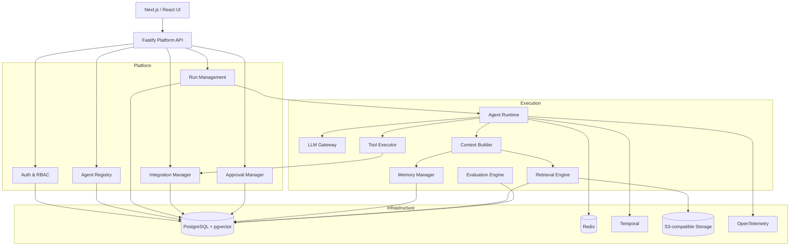
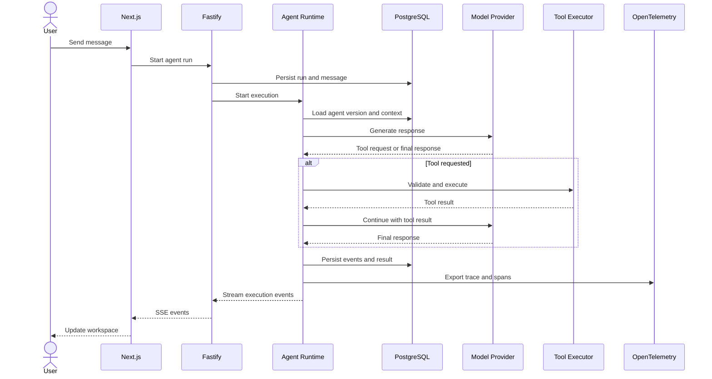

# Relay — Project Specification

**Document:** Product, Architecture & Implementation Specification  
**Project:** Relay (formerly "Workforce", working name)  
**Category:** AI Engineering Platform / Agent Operations Workspace  
**Goal:** build a portfolio project that demonstrates practical command of AI Engineering, systems architecture and the operation of LLM-based applications.  
**Version:** 0.3. Content as in 0.2 (reconciled with the "Relay — Clean Technical" v0.2 design canvas, `docs/design/canvas/`), translated to English.  
**Role in SDD:** the highest-level product document. Each phase's specs (`docs/specs/`) derive from it and cannot contradict it without updating this document first.

> When this document and the design diverge, section 15 (Design reconciliation log) explains which of the two prevailed and why.

> The goal is not just to build an interface for chatting with agents. Relay must make it possible to define, run, integrate, observe, evaluate and improve AI agents and workflows.

---

# 1. Product vision

Relay is a platform for developing and operating AI agents connected to tools, knowledge sources and workflows.

The platform offers a single environment to:
- Create and configure agents.
- Talk to agents and follow their executions.
- Connect tools and external systems.
- Manage context and memory.
- Build RAG pipelines.
- Orchestrate durable workflows.
- Require human approval for sensitive actions.
- Inspect traces, spans, logs and costs.
- Evaluate quality and compare agent versions.

## 1.1 Learning goal

The project should work as a hands-on AI Engineering lab. The focus is on understanding flows, responsibilities and trade-offs, not just producing code.

By the end, it should be possible to demonstrate:
1. How an LLM receives context and produces responses.
2. How an agent's execution cycle works.
3. How the model requests tools and how the backend executes them safely.
4. How to manage history, context and memory.
5. How to build and evaluate a RAG pipeline.
6. How to run workflows with durable state, retries and approvals.
7. How to instrument and debug executions.
8. How to evaluate agent quality systematically.
9. How to protect data, tools, credentials and operations.
10. How to design an extensible architecture without premature complexity.

## 1.2 Principles

- **Engineering-first:** favor AI Engineering concepts and capabilities.
- **Observable by design:** every relevant execution must be traceable.
- **Explicit control:** the model is not an authorization authority.
- **Modular architecture:** separate responsibilities without starting with microservices.
- **Provider-agnostic where useful:** allow swapping providers without erasing important differences.
- **Build to understand:** implement the fundamentals before delegating everything to frameworks.
- **Progressive complexity:** add components when there is a concrete need.

---

# 2. Functional scope

## 2.1 Modules

| Module | Responsibility | Priority |
|---|---|---|
| Home | Operational summary and items that need attention | P0 |
| Activity | History of executions and events | P0 |
| Agents | Agent directory and workspaces | P0 |
| Agent Settings | Full configuration of each agent | P0 |
| Workflows | Process definition and execution | P0 |
| Integrations | Connections, tools and providers | P0 |
| Knowledge | Document ingestion and RAG | P0 |
| Traces | Inspection of traces, spans and executions | P0 |
| Evaluations | Datasets, scorers and experiments | P0 |
| Settings | Workspace administration | P1 |
| Analytics | Aggregated usage, quality and cost metrics | P1 |

P0 is the core needed to demonstrate the technical proposition. P1 is complementary capability.

## 2.2 Sidebar and navigation

Reference: `docs/design/canvas/Sidebar.dc.html` (248px wide, `Sidebar #F5F5F6` background).

```text
┌──────────────────────────────────┐
│ [A] Acme Corporation  ⇅     [◧]  │  workspace selector · collapse
├──────────────────────────────────┤
│ 🔍 Search                   ⌘K   │  command palette
├──────────────────────────────────┤
│ Home                             │
│ Activity                      3  │  counter = runs that need attention
│ Workflows                        │
│ Integrations                     │
├──────────────────────────────────┤
│ DRAFTS                       [+] │
│  ⊕ New agent                     │
├──────────────────────────────────┤
│ AGENTS                       [+] │  independent scroll
│  ◆ Finance Assistant     ●       │  agent icon + status dot
│  ● Support Triage        ●       │
│  ■ Contract Reviewer     ●       │
│  ▲ Invoice Intake        ●       │
│  ⬢ IT Access Desk        ●       │
│  …                               │
├──────────────────────────────────┤
│ ENGINEERING                      │
│  Traces                          │
│  Evaluations                     │
│  Knowledge                       │
│  Analytics                (P1)   │
├──────────────────────────────────┤
│ [AM] Ana Moreira          ⇅      │  account menu → Settings, Profile, Sign out
└──────────────────────────────────┘
```

Rules:
- Agents are first-class entities and appear directly in the sidebar.
- Selecting an agent opens its conversation workspace.
- The settings icon (gear) in the workspace header opens the **agent details panel** (see 2.5).
- Drafts holds agents that have not been published yet.
- The `+` button in Agents starts creating an agent.
- The full directory is reachable via `View all`.
- Do not duplicate navigation with an administrative agents section that repeats the list.
- The agent list in the sidebar scrolls independently.
- Each agent's status dot comes with accessible text (e.g. ", Waiting for approval"), so color is never the only signal.
- The agent's visual state also shows in its icon (`mood`): `awake` (normal), `error` (recent failure) and `sleep` (paused).
- Settings is reached from the account menu in the footer. It administers the workspace and must not hide engineering tools, which live in the Engineering section.
- Analytics (P1) only appears once there is instrumentation to feed it (Phase 7+). Before that, the entry stays hidden.
- The sidebar can collapse to an icon-only bar.
- `⌘K` / `Ctrl+K` opens global search: agents, traces, workflows and pages.

## 2.3 Home

Reference: `docs/design/canvas/Main.dc.html`.

Home must be a lean operations center, not a BI dashboard.

It must answer:
1. What is happening?
2. What needs attention?
3. How do I get to the relevant execution quickly?

Layout (central column, `max-width: 880px`):
1. **Header:** title "Your AI workspace", a short subtitle and quick actions: `Traces`, `Run evaluation` and `New agent` (primary).
2. **Today's indicators:** a strip with three clickable metrics (Runs today, Success rate, Avg. latency). Each one leads to the corresponding filtered list.
3. **Needs attention · N:** a list of actionable items. Each row shows the agent icon, the name, the state (Failed, Approval), a detail ("Tool call failed · Parse PDF"), relative time and a direct action (`Open trace →`, `Review execution →`).
4. **Recent executions:** a table with Agent, Trace ID (mono, link), Duration, When and Status, plus the `All traces →` link.

Rules:
- No chart without an associated action.
- No huge cards per agent.
- No fake data presented as real. Without data, each section shows its *empty state* (see 2.12).
- "Needs attention" only aggregates: failed runs not yet investigated, pending approvals and connections that are expiring or failing.

## 2.4 Activity

Operational history center:
- List of agent runs and workflow runs.
- Filters by agent, workflow, status and period.
- Identifier, status, duration, time and cost when available.
- Link to open the full trace.
- Indication of executions waiting for approval.
- Event details and final result.

## 2.5 Agents

### Directory
- Agent list, search and filters.
- Publication and execution state.
- Configured model and last execution.
- Access to the workspace.
- Actions: duplicate, pause, resume and archive.

### Agent Workspace

Reference: `docs/design/canvas/AgentWorkspace.dc.html` (interactive).

The workspace puts the conversation first. Three-column layout:
1. Global sidebar.
2. Central conversation area.
3. Contextual panel on the right, with **one panel at a time**: `Details` (gear) or `Activity`. It can also be closed.

**Header:** agent icon, name, agent state ("Waiting for approval"), published version ("· v7 published") and three buttons: Activity, Details (gear) and More actions (`⋯`: duplicate, pause/resume, archive).

**Conversation:**
- User messages in a bubble (`Bubble #F0F1F2`, 18px radius), right-aligned.
- Agent responses have a header (icon, name and timestamp) and can contain structured blocks, such as a table of invoice lines with a total, or a check line ("✓ Amount and goods receipt match the purchase order.").
- Support for history, streaming, execution states, tool calls as events, failures, retries and links to traces.
- **Inline approval card** when the runtime pauses on a sensitive operation. The card is key–value: Action, Amount, Tool (`create_payment`) and the Policy that triggered it ("Payments above €1,000 need approval"). It includes the sentence "Nothing is paid until someone approves." and the `Reject` and `Approve payment` buttons.
  - Approval is decided by the backend (policy). The model only *proposes* the operation. The card shows the policy that required approval so the user understands the rule.
- **Composer:** attach file, text field and send. The voice button appears in the design but is outside the MVP (multimodal, Phase 10).

**Activity panel** (current or selected execution):
- Key–value summary: Status, Trace (`tr_…` link), Duration · Tokens and Cost.
- Ordered list of steps, each with name, duration and state: `Plan · 3 steps`, `search_invoices`, `match_purchase_order` and `create_payment` (waiting for approval).
- Fixed note: "Shows actions, arguments and results authorised for inspection. Model reasoning is not displayed."
- The `Plan` step shows **only an operational summary** emitted as an event ("Find invoice, verify, request payment"), never the model's internal reasoning.

Do not display private chain-of-thought. Display events, actions, arguments and results that are safe and authorized for inspection.

### Agent Settings (Details panel)

The gear opens the `Details` panel on the right, without leaving the conversation. The panel uses *drill-down* navigation: the root shows groups of rows, and each row opens a sub-view with a back button. Complex sections (Instructions, Versions) can open in a wider view if the panel is too narrow.

**Panel root:**
- Agent icon (60px), with a button to change it, and "v7 · Published".
- Inline fields: `Name` and `What it does` (short description).
- Groups (user-facing language → corresponding technical section):

| Group | Row (UI) | Example value | Technical section | Content |
|---|---|---|---|---|
| Work | Tasks | 2 tasks | Tasks | Jobs assigned to the agent (see note) |
| Work | Model | Automatic | Model | Provider, model, parameters, limits and fallback |
| Knows | Instructions | — | Instructions | System instructions, templates and behavior |
| Knows | Files & sheets | 2 files | Knowledge | Available collections and sources |
| Uses | Tools | 4 | Tools | Active tools and allowed operations |
| Uses | Connections | Expires in 3d | Connections | Authenticated connections (with expiry warning) |
| Rules | Always asks you | 1 | Permissions → approvals | The agent's approval rules |
| Rules | Schedule | Mon–Fri, 8–19h | Schedule | Operating window (see note) |
| More | Memory | 90 days | Memory | Scope, read, write and retention |
| More | Permissions | — | Permissions | Autonomy and limits |
| More | Versions | v7 | Versions | History, comparison and rollback |
| More | Advanced | — | Advanced | Timeout, retries and runtime options |

The `General` technical section (name, description and identity) lives at the top of the panel, without its own row.

**Tools sub-view** (the one designed in detail):
- Shows the connection the tools operate through ("Through SAP S/4 — production") and the guidance rule: "Write tools that move money should ask you first."
- Each tool has a name (mono), a short description and an **Enabled** toggle.
- **Write** tools have a second toggle, **Asks you before running**, which requires human approval.
- `Add` button to attach more tools from the connection.

**Draft → publish model:**
- Changing any setting creates local changes and shows a fixed bar at the bottom of the panel: "● Unsaved changes · Discard · Publish v8".
- Publishing creates a new **immutable agent version**. The previous version stays available for comparison and rollback. Runs always reference the exact version they ran with.

**Notes on new sections coming from the design:**
- **Tasks:** concept still open. The hypothesis is that a task is a recurring or triggered instruction ("pay approved invoices on Fridays"), which overlaps with Workflows that have a trigger. Deferred to the Phase 6 spec, which decides whether Tasks is a simplified workflow or an entity of its own. In the MVP, the row shows only a placeholder.
- **Schedule:** the time window in which the agent may perform autonomous actions. Outside the window, trigger-started executions are queued or refused. It is P1.
- **Model "Automatic":** in the MVP it means "use the workspace's default model". Real model routing is Phase 9/10.

Keep separate:
- Connection: authenticated access to a system.
- Tool: an operation that can be executed on that system.
- Agent permission: authorization for an agent to use a given operation.

The design embodies this separation: the connection appears as context in the Tools sub-view, the *Enabled* toggle is the agent's permission and the *Asks you before running* toggle is an approval rule.

### States: agent vs. execution

The design uses similar words for different things. They are two distinct state machines:

| Agent lifecycle (definition) | Run status (execution) |
|---|---|
| `draft` (never published) | `queued` |
| `active` (published, accepts runs) | `running` |
| `paused` (published, does not accept new runs) | `waiting_approval` |
| `archived` | `completed` |
| | `failed` |
| | `cancelled` |

The **state shown in the sidebar and in the header** is derived and not stored:
- `paused` or `draft` → show the lifecycle.
- Otherwise, show the most relevant run: `waiting_approval` > `running` > `failed` (recent and unresolved) > `active`.

UI labels: Active, Running, Waiting for approval, Failed (run) / Error (agent with a recent failure), Draft and Paused.

## 2.6 Workflows

Visual editor for processes made of deterministic steps and agent calls.

Planned nodes:
- Trigger.
- Agent.
- Tool.
- Condition.
- Transform.
- Approval.
- Delay.
- HTTP request.
- End.

Capabilities:
- Canvas with zoom and pan.
- Connections between nodes.
- Node configuration and validation.
- Retry and timeout per step.
- Error handling.
- Version history.
- Inspection of a specific execution.

Separate Builder Mode from Run Inspection Mode. Editing a workflow must not be mixed with inspecting an execution.

## 2.7 Integrations

Management of providers, connections and tools.

Future categories: CRM, ERP, Productivity, Communication, Databases, Storage, Custom APIs and MCP Servers.

Features:
- Integration catalog.
- Create and revoke connections.
- Manage credentials securely.
- Discover available tools.
- Attach tools to agents.
- Configure permissions.
- Inspect errors and connection state.

## 2.8 Knowledge

Module for ingesting, indexing, retrieving and evaluating sources:
- Document upload.
- Sources and collections.
- Parsing and extraction.
- Chunking.
- Embeddings.
- Vector indexing.
- Metadata filters.
- Retrieval Playground.
- View of retrieved chunks.
- Reranking, once implemented.
- Ingestion history and errors.

## 2.9 Traces

Observability module:
- Trace Explorer.
- Filters by agent, workflow, status, model and period.
- Hierarchical span tree.
- Timeline/waterfall.
- Authorized inputs and outputs.
- LLM calls, tool calls and retrieval calls.
- Duration per step.
- Tokens and estimated cost.
- Errors and retries.
- Correlation with agent version, workflow run and logs.

Concepts:
- Trace: one complete execution.
- Span: one operation inside the execution.
- Logs: recorded events and messages.
- Metrics: aggregated values such as latency and error rate.

## 2.10 Evaluations

Module for measuring quality and detecting regressions:
- Evaluation datasets.
- Test cases and expected outputs.
- Deterministic evaluators.
- LLM-as-a-judge.
- Human review.
- Experiments.
- Comparison of versions and models.
- Results history.

Possible metrics: correctness, relevance, faithfulness, tool selection accuracy, tool argument correctness, retrieval quality, instruction following, safety, latency and cost.

## 2.11 Settings

Reference: `docs/design/canvas/WorkspaceSettings.dc.html`.

Grouped list. Each row has an icon, title, short description, current value and chevron:

| Group | Item | Description | Example value | Priority |
|---|---|---|---|---|
| Agents | Approval policies | Which actions need a person to approve | 3 policies | P0 |
| Workspace | General | Name, region and defaults | Acme Corporation | P0 |
| Workspace | Members & roles | Who can operate, configure and approve | 38 members | P1 |
| Workspace | Security & policies | Agent policies and tool restrictions | — | P1 |
| Workspace | Audit log | Every approval, change and access | — | P1 |
| Workspace | Data retention | How long runs and conversations are kept | 90 days | P1 |
| Workspace | Secrets | Credentials stored for connections | 12 secrets | P0 |
| Personal | Profile | Name, email and sign-in | — | P0 |
| Personal | Notifications | Approvals, failures and digests | Approvals only | P1 |
| Personal | Appearance | Theme and density | Light | P1 |

**Approval policies: workspace vs. agent.**
- *Workspace policies* (Settings) set the **floor**: for example, "payments above €1,000 require approval".
- *Agent rules* ("Always asks you" and the per-tool toggle) can only make the agent **more restrictive**, never less.
- Evaluation happens in the backend, before the tool runs: `requires_approval = workspace_policy(op) OR agent_rule(op)`.

Roles (P1) separate who **operates** (talks to and runs agents), who **configures** (edits and publishes agents) and who **approves** (decides approvals).

Do not implement every enterprise feature in the first version.

## 2.12 Design system — Clean Technical

Reference: `docs/design/canvas/Foundations.dc.html`. The tokens below are the source of truth for the Tailwind/shadcn theme.

**Principle:** white canvas, very light sidebar, near-invisible borders and graphite text. Green is used only for positive actions. Cards only when grouping requires them.

**Colors:**

| Token | Hex | Use |
|---|---|---|
| canvas | `#FFFFFF` | Main background |
| sidebar | `#F5F5F6` | Sidebar, empty states, disabled |
| surface | `#EBECEE` | Active navigation item, pressed panel button |
| text | `#24272D` | Text, primary button (graphite) |
| text-muted | `#656A72` | Labels, metadata |
| text-disabled | `#A3A7AE` | Disabled text |
| border | `#E6E7EA` | Outline of groups and tables |
| border-control | `#E1E2E5` | Secondary buttons and inputs |
| divider | `#ECEDEF` | Internal separators |
| bubble | `#F0F1F2` | Message bubbles |
| accent | `#69A987` | Fills, dots, icons, focus ring |
| accent-text | `#3F7A5B` (hover `#2C5A42`) | Links and green text (contrast ≥ 4.5:1) |

**States** (text / dot):

| State | Text | Dot |
|---|---|---|
| Active / Completed | `#2E7D57` | `#69A987` |
| Running | `#2F6FC4` | `#2F6FC4` |
| Waiting for approval / Paused | `#9A5F0C` | `#D89A3C` |
| Failed / Error | `#C2414B` | `#C2414B` |
| Draft | `#656A72` | `#A3A7AE` |

Rule: a state is always **dot + text label**. Color is never the only signal. In Home's attention lists a subtle tinted background is allowed (e.g. `rgba(194,65,75,0.08)`); elsewhere in the product filled badges are not used.

**Typography:** Geist (UI) and Geist Mono (IDs, tokens, costs, tool names).

| Role | Size/weight |
|---|---|
| Page title | 26 / 600, letter-spacing −0.01em |
| Section | 16 / 600 |
| Body | 14–15 / 400, line-height 1.45 |
| Label | 13 / 400, muted |
| Mono | 12 / 400, `tabular-nums` for numbers |

**Radii and elevation:** 6px (tabs and small elements), 8px (buttons and inputs), 10px (groups and cards), 18px (bubbles), `shadow-xs: 0 1px 2px rgba(36,39,45,0.08)` for selected elements.

**Base components:**
- Buttons (height 36, or 34 in toolbars): `Primary` (graphite), `Secondary` (white with border), `Positive` (accent background with graphite text), `Destructive` (`#C2414B` text on white background) and `Disabled`.
- Focus: `outline: 2px solid #69A987; outline-offset: 2px`.
- Inputs: height 40, label above in 13px muted. Errors use a `#C2414B` border and a 12px message below ("Exceeds the model's limit of 64,000.").
- Grouped list: rows with 12/14px padding, with label, muted value and chevron.
- Key–value card: `100px 1fr` grid, used in approvals and in the run summary.
- Switch: 34×20 (on in graphite, off in `#D5D7DB`), with `role="switch"`.
- Empty state: `sidebar` background, title, explanation and one action ("No traces in this period · Traces appear once an agent runs. · Clear filters").
- Icons: Lucide, stroke 1.7–2.

**Agent icon:** each agent has a generated visual identity (shape, color and eyes) with three *moods*: `awake` (blinks and floats), `error` (X eyes) and `sleep` (closed eyes, desaturated). The icon is stored as agent configuration (`icon: { shape, color }`) and the mood derives from the state (see "States: agent vs. execution"). Available shapes and colors: see `AgentIcon.dc.html`.

**Theme:** the design only covers the light theme. Dark mode is planned (Settings → Appearance) but not designed. Tokens must be defined as CSS variables to allow it later.

**Accessibility:** landmarks (`nav`, `main`, `aside` with `aria-label`), `aria-current="page"` in navigation, `aria-pressed` on panel buttons and click targets ≥ 34px.

---

# 3. Technical architecture

## 3.1 Architectural style

Start with a **modular monolith**, alongside separate workers for asynchronous tasks.

Do not start with a microservice per module. The logical separation should allow future extraction, but deployment should stay simple while the system is small.

## 3.2 Layers

### Experience Layer
Next.js, React, TypeScript, chat and streaming, agent workspace, workflow builder, traces and evaluations.

### Platform Layer
API, authentication and authorization, multi-tenancy, agent registry, agent versions, conversations, runs, tool registry, connections, approvals and workspace administration.

### AI Execution Layer
LLM Gateway, Agent Runtime, Context Builder, Tool Executor, Memory Manager, Retrieval Engine and Evaluation Engine.

### Infrastructure & Data Layer
PostgreSQL, pgvector, Redis, Object Storage, Temporal and OpenTelemetry.

## 3.3 Logical diagram



The boxes are logical responsibilities, not necessarily independent services.

## 3.4 Agent execution flow



An execution must not depend on the HTTP connection staying open. State and events must be persisted to survive browser disconnections.

---

# 4. Technologies

## 4.1 Main stack

| Layer | Technology | Reason |
|---|---|---|
| Frontend | Next.js + React | Interface and routing |
| Language | TypeScript | Typing and contracts |
| UI | Tailwind CSS + shadcn/ui | Design system |
| Data fetching | TanStack Query | Cache and remote state |
| Local state | Zustand | Shared local state |
| Forms | React Hook Form + Zod | Forms and validation |
| API | Node.js + Fastify | Main backend |
| ORM | Drizzle ORM | Typed PostgreSQL access |
| Validation | Zod | Contracts and schemas |
| Logs | Pino | Structured logs |
| Database | PostgreSQL | Relational persistence |
| Vector search | pgvector | Embeddings and retrieval |
| Cache | Redis | Cache and temporary coordination |
| Object storage | S3-compatible / R2 | Documents and artifacts |
| Durable workflows | Temporal | Durable execution |
| Observability | OpenTelemetry | Traces, metrics and propagation |
| Testing | Vitest + Playwright | Unit and E2E tests |
| Monorepo | pnpm + Turborepo | Code organization |
| Local infrastructure | Docker Compose | Local environment |

## 4.2 Node.js and Python

### Node.js / TypeScript — main platform

Use for the API, the domain, the initial Agent Runtime, the LLM Gateway, the Tool Registry, the Tool Executor, the Context Builder, integrations and streaming.

### Python / FastAPI — specialized services, if needed

Use later for specialized document parsing, OCR, ML experiments, specialized evaluation pipelines or AI libraries that bring a concrete advantage.

Do not create a Python service just to make LLM calls. Start with TypeScript and introduce Python when there is a clear technical need.

## 4.3 LLM providers

Start with one provider and add a second to study the differences in APIs and capabilities.

Suggested abstraction:

```ts
interface ModelProvider {
  generate(input: ModelRequest): Promise<ModelResponse>;
  stream(input: ModelRequest): AsyncIterable<ModelEvent>;
  getCapabilities(): ModelCapabilities;
}
```

The abstraction must preserve important differences between models. Do not assume they all support the same parameters, structured outputs, tools or modalities.

## 4.4 Agent Runtime

Implement the agent loop by hand at first.

Study frameworks such as LangGraph after understanding the agent loop, state, tool calling, context management, handoffs, limits and stop conditions.

The runtime must be shared by many agent definitions. An agent is configuration and state, not an independent software process.

## 4.5 Temporal

Use for durable workflows and for processes that need to wait for approval, resume after interruptions, run retries, survive restarts and enforce timeouts.

The Agent Runtime runs the reasoning cycle. Temporal orchestrates durable processes. They are complementary responsibilities.

---

# 5. Persistence and data model

## 5.1 PostgreSQL

Main database and source of truth.

Initial entities:

| Entity | Responsibility |
|---|---|
| organizations | Organizations |
| users | Users |
| memberships | Users and organizations |
| agents | Agent definitions |
| agent_versions | Immutable versions |
| conversations | Conversations |
| messages | Messages |
| agent_runs | Executions |
| run_events | Execution events |
| tool_definitions | Tool definitions |
| tool_executions | Tool executions |
| connections | External connections |
| workflows | Workflow definitions |
| workflow_versions | Workflow versions |
| workflow_runs | Workflow executions |
| approvals | Approvals |
| knowledge_sources | Knowledge sources |
| documents | Documents |
| document_chunks | Processed chunks |
| evaluation_datasets | Datasets |
| evaluation_cases | Test cases |
| evaluation_runs | Experiments |
| approval_policies | Workspace approval policies (the floor) |
| agent_tool_permissions | Active tools per agent version and the "asks before running" rule |
| secrets | References to credentials (the value is stored encrypted, never in plain text) |
| audit_log | Record of approvals, changes and accesses (P1) |

Fields the design makes explicit:
- `agents`: `lifecycle_status` (draft, active, paused, archived), `icon_shape`, `icon_color`, `description` ("What it does"), `current_version_id`.
- `agent_versions`: sequential number (`v7`), immutable snapshot of the whole configuration, and `published_at`/`published_by`.
- `agent_runs`: `status` (queued … cancelled), `agent_version_id`, `trace_id`, `duration_ms`, `input_tokens`, `output_tokens`, `cost_estimate`.
- `connections`: `status`, `environment` (e.g. production) and `expires_at`, which feeds the "Expires in 3d" warning.
- `approvals`: `run_id`, `tool_execution_id`, `policy_id` (the policy that triggered it), `decision`, `decided_by` and `decided_at`.

## 5.2 pgvector

Use it at first as a PostgreSQL extension to store embeddings, search by similarity, apply metadata filters and experiment with vector search and hybrid search.

Do not introduce a separate vector database without evidence that it is needed.

## 5.3 Redis

Use for rate limiting, cache, locks and coordination, ephemeral streaming state when needed, and pub/sub where applicable.

Do not use Redis as the source of truth for executions or for data that needs durable persistence.

## 5.4 Object Storage

Store original documents, PDFs and DOCX, uploaded files, evaluation artifacts and generated files.

PostgreSQL stores metadata and references to the objects, not the binaries in general.

## 5.5 Persistence rules

- Business entities must be scoped to an organization/workspace where applicable.
- Data from different tenants must be isolated.
- Agent definitions and published versions must be separate.
- Agent runs and workflow runs must be distinct entities.
- Execution events must be persisted.
- Credentials must be stored through a secure mechanism, never in plain text or in prompts.
- Logs and traces must redact sensitive data.

---

# 6. Observability and tracing

## 6.1 OpenTelemetry

Instrument HTTP requests, agent runs, LLM calls, tool calls, retrieval, workflow activities, errors and retries.

## 6.2 Trace model

```text
Trace: Finance Assistant
│
├── Agent initialization
├── Context assembly
├── LLM call
├── Tool call: search_invoice
├── LLM call
├── Tool call: match_purchase_order
└── Approval requested
```

Every relevant operation must produce correlated spans.

## 6.3 Useful data

- Trace ID.
- Span ID and parent span.
- Agent ID and version.
- Workflow/run ID.
- Provider and model.
- Prompt version.
- Duration.
- Input and output tokens.
- Estimated cost.
- Status and error.
- Authorized inputs/outputs.

Do not record private chain-of-thought. Record operational events and the data needed for debugging, with privacy controls.

---

# 7. Security and governance

Study and implement progressively:
- Authentication and RBAC.
- Tenant isolation.
- Least privilege.
- Secrets management.
- OAuth 2.0.
- Prompt injection and indirect prompt injection.
- Tool abuse and data exfiltration.
- SSRF.
- Rate limiting.
- Audit logs.
- PII redaction.
- Secure tool execution.
- Approval policies.

Mandatory rules:
1. The model never receives credentials directly.
2. The model does not decide permissions.
3. The backend checks authorization before executing a tool.
4. Sensitive operations may require human approval.
5. External inputs are treated as untrusted content.
6. Data from different tenants must never be mixed.
7. Logs and traces must not expose secrets.
8. Tools must have minimal scope.

---

# 8. Monorepo structure

Suggested target structure:

```text
relay/
├── apps/
│   ├── web/                    # Next.js
│   ├── api/                    # Fastify
│   ├── worker/                 # Agent execution workers
│   └── ai-service/             # Python, if needed later
│
├── packages/
│   ├── database/               # Schema, migrations, queries
│   ├── contracts/              # API contracts
│   ├── validation/             # Zod schemas
│   ├── agent-runtime/          # Agent loop and execution
│   ├── llm/                    # Provider abstraction
│   ├── tools/                  # Tool registry and executor
│   ├── memory/                 # Memory management
│   ├── retrieval/              # RAG and retrieval
│   ├── workflows/              # Workflow definitions
│   ├── evaluations/            # Evaluation engine
│   ├── observability/          # Tracing and instrumentation
│   ├── integrations/           # External connectors
│   └── ui/                     # Shared UI components
│
├── infrastructure/
│   ├── docker/
│   ├── temporal/
│   └── observability/
│
├── docs/
│   ├── product/                # This document (product spec)
│   ├── design/                 # Design canvas and tokens
│   ├── architecture/
│   ├── adr/
│   ├── specs/                  # SDD specs per phase/feature
│   ├── concepts/               # Learning notes
│   └── experiments/
│
├── docker-compose.yml
├── pnpm-workspace.yaml
└── turbo.json
```

This is a target structure, not a requirement for the first commit. Create modules as they are needed.

---

# 9. Implementation order

## Phase 0 — Product & Architecture Foundation

**Goal:** prepare the project's foundation.

Study and implement:
- MVP requirements and limits.
- Monorepo with pnpm and Turborepo.
- Next.js.
- Fastify.
- PostgreSQL.
- Drizzle.
- Docker Compose.
- Contracts and validation.
- Basic authentication.
- Modular backend organization.
- First ADRs.

**Outcome:** initial application, working API, database and reproducible local environment.

## Phase 1 — LLM Gateway

**Goal:** understand communication with models.

Study tokens, context window, roles, sampling, streaming, provider APIs, rate limits, retries, structured outputs, usage and cost.

Implement:
- Provider adapter.
- Model request/response.
- Token streaming.
- Error normalization.
- Usage recording.

**Outcome:** a model lab integrated into the platform.

## Phase 2 — Agent Runtime

**Goal:** build the first working agent.

Study the agent loop, Context Builder, tool calling, tool schemas, state, iteration limits, timeout, cancellation, and persistence of messages and events.

Implement:
- Agent definitions and versions.
- Conversations.
- Agent runs.
- Shared runtime.
- First conversation workspace.

**Outcome:** an agent able to converse and run a basic decision cycle.

## Phase 3 — Tools & Integrations

**Goal:** let agents interact with external systems.

Study function calling, tool registry, schemas, REST APIs, OAuth 2.0, API keys, rate limits, idempotency, authorization and secrets.

Implement:
- Tool definitions.
- Tool executor.
- Connection manager.
- Per-agent permissions.
- One read integration.
- One write integration with approval.

**Outcome:** an agent that performs external operations with access control.

## Phase 4 — Memory

**Goal:** understand persistent context and memory.

Study history versus memory, short-term and long-term memory, scope, isolation, extraction, retrieval, retention and deletion.

Implement:
- Session memory.
- Controlled persistence.
- Retrieval of relevant memory.
- Retention policies.

**Outcome:** an agent that keeps context across interactions according to explicit policies.

## Phase 5 — Knowledge & RAG

**Goal:** build the knowledge retrieval pipeline.

Study document parsing, chunking, embeddings, pgvector, similarity search, metadata filtering, hybrid search, reranking and retrieval evaluation.

Implement:
- Document upload and storage.
- Ingestion pipeline.
- Configurable chunking.
- Embedding generation.
- Vector search.
- Retrieval Playground.
- Integration of retrieved context into the agent.

**Outcome:** an agent that answers from documents and lets you inspect the retrieved passages.

## Phase 6 — Workflow Orchestration

**Goal:** run durable, stateful processes.

Study DAGs, nodes and edges, workflow state, conditions, branching, retries, timeouts, durable execution, Temporal, signals and human-in-the-loop.

Implement:
- Workflow definitions and versions.
- Workflow runs.
- Nodes and transitions.
- Approval step.
- Pause/resume.
- Retry and error handling.

**Outcome:** a process with an agent, tools, a condition, an approval and resumption after interruption.

## Phase 7 — Observability & Traces

**Goal:** make executions inspectable.

Study logs, metrics and traces, OpenTelemetry, trace and span, parent-child relationships, context propagation, instrumentation of LLMs and tools, latency and cost.

Implement:
- Runtime instrumentation.
- LLM, tool and retrieval spans.
- Correlation with runs and workflows.
- Trace Explorer.
- Trace Detail.
- Timeline and error inspection.

**Outcome:** the ability to reconstruct and investigate a complete execution.

## Phase 8 — Evaluations

**Goal:** measure and improve agent quality.

Study datasets, test cases, expected outputs, deterministic evaluators, LLM-as-a-judge, human review, scoring, regression testing and model comparison.

Implement:
- Dataset manager.
- Evaluation runner.
- Scorers.
- Version comparison.
- Results reports.

**Outcome:** run a test suite and measure whether a new version improved or regressed.

## Phase 9 — Security & Optimization

**Goal:** strengthen reliability and efficiency.

Study prompt injection, tool abuse, tenant isolation, least privilege, secrets, PII redaction, model routing, fallback, caching, token budgets and rate limiting.

Implement:
- Authorization tests.
- Isolation tests.
- Tool protection.
- Approval policies.
- Model fallback.
- Cost and execution limits.

**Outcome:** a platform with security controls and more predictable operation.

## Phase 10 — Advanced additions

Only after the core:
- Multi-agent orchestration.
- Multimodal AI.
- Advanced OCR.
- Sophisticated model routing.
- Advanced analytics.
- Python AI services.
- Dedicated deployment.
- Enterprise administration.

---

# 10. What not to build at first

To stay focused:
- Training an LLM from scratch.
- Fine-tuning our own models.
- Kubernetes without need.
- Microservices by default.
- Many providers at once.
- Dozens of integrations.
- Multi-agent orchestration before mastering a single agent.
- A separate vector database before trying pgvector.
- A Python service without a concrete need.
- Billing and monetization.
- SSO and SCIM.
- Self-hosted/on-premise.
- Full enterprise compliance.
- Advanced analytics before instrumentation.

---

# 11. Quality and testing

| Type | What to validate |
|---|---|
| Unit tests | Domain rules, runtime and validation |
| Integration tests | Database, simulated providers and tools |
| Contract tests | API, tool and event schemas |
| E2E tests | Main interface flows |
| Evaluation tests | Agent quality and behavior |
| Security tests | Authorization, isolation and prompt injection |
| Load tests | Concurrency, latency and limits |

LLM evaluations do not replace deterministic tests. Each kind of test covers a different class of failure.

---

# 12. Completion criteria

The project is technically demonstrable when it is possible to:

1. Create and version an agent.
2. Configure provider, model and instructions.
3. Run an agent loop with tool calling.
4. Restrict tools per agent.
5. Persist conversations and executions.
6. Retrieve memory according to the configured scope.
7. Do RAG over documents and inspect the chunks.
8. Run a durable workflow.
9. Interrupt the process for human approval and resume it.
10. Inspect the full trace of an execution.
11. Run an evaluation dataset.
12. Compare two versions of an agent.
13. Demonstrate that an unauthorized operation is blocked.
14. Explain architectural decisions and trade-offs.

## 12.1 Portfolio documentation

For each relevant capability, produce:
- A technical README.
- An architecture diagram.
- A sequence diagram.
- An ADR with alternatives and rationale.
- Experiments and results.
- Success and failure tests.
- Example traces.
- An evaluation report.
- Security notes.

The portfolio must show understanding and the ability to explain the system, not just screenshots.

---

# 13. Initial architecture decisions

| Decision | Initial choice | Reason |
|---|---|---|
| Architecture | Modular monolith | Lower initial complexity |
| Frontend | Next.js + React | Ecosystem and experience |
| Backend | Fastify + TypeScript | Typed, modular API |
| AI runtime | Own initial implementation | Learn the agent loop and tool execution |
| Python | Add when needed | Avoid a premature service |
| Main database | PostgreSQL | Relational and transactional data |
| Vector search | pgvector | RAG without extra infrastructure |
| Cache | Redis | Temporary state and coordination |
| Files | S3-compatible | Keep binaries out of the database |
| Durable workflows | Temporal | Processes that survive interruptions |
| Observability | OpenTelemetry | Standardized instrumentation |
| Monorepo | pnpm + Turborepo | Sharing and organization |

These decisions are initial hypotheses and must be revisited through an ADR when requirements or evidence justify a change.

---

# 14. Final definition

**Relay is an AI Engineering platform for building, running, integrating, observing and evaluating AI agents and workflows.**

The project's technical value lies in the coherent integration of:

```text
LLM Providers
     |
     v
Context Engineering
     |
     v
Agent Runtime
     |
     v
Tool Execution
     |
     v
Memory & RAG
     |
     v
Workflow Orchestration
     |
     v
Observability
     |
     v
Evaluations & Improvement
```

> The goal is not just to make agents work. It is to understand and demonstrate how to build AI systems that are reliable, observable, evaluable and controllable.

---

# 15. Design reconciliation log

Design canvas v0.2 was produced after the original spec. Below are the divergences found and the decision made for each.

| # | Topic | Original spec | Design | Decision | Why |
|---|---|---|---|---|---|
| R1 | Name | Workforce | Relay | **Relay** | The project's final name. |
| R2 | Opening agent settings | Dedicated area | Drill-down side panel in the conversation | **Design** | Configure without losing the conversation's context. Large sections can expand. |
| R3 | Settings organization | 10 technical sections | 5 groups in user language | **Both** | The groups are the UI layer and the sections are the domain model. The mapping is in the table in 2.5. |
| R4 | Tasks and Schedule | Absent | Present | **Add as open / P1** | Tasks overlaps with Workflows and is decided in the Phase 6 spec. Schedule is P1. |
| R5 | Model "Automatic" | Explicit fallback | "Automatic" | **= workspace default in the MVP** | Sophisticated routing is out of initial scope (section 10). |
| R6 | Analytics in the sidebar | P1, outside the sidebar | In the Engineering section | **Show only from Phase 7** | The spec forbids analytics before instrumentation. |
| R7 | Settings in the sidebar | Own item | Via account menu | **Design** | The sidebar stays focused on operational work. |
| R8 | States | A single list | Labels mix agent and run | **Two state machines + derived state** | Avoid confusing the agent's definition with its execution. See 2.5. |
| R9 | Approval policies | In the agent's Permissions | Settings → Agents + "Always asks you" + per-tool toggle | **Workspace = floor; agent only restricts** | Least privilege: neither the model nor the agent's configuration can loosen a policy. |
| R10 | Voice in the composer | — | Microphone button | **Outside the MVP** | Multimodal is Phase 10. |
| R11 | "Plan" step in Activity | Forbids chain-of-thought | Shows "Plan · 3 steps" | **Allowed as a summary event** | A declared plan is an operational event, not private reasoning. |
| R12 | Badges | — | Foundations: "no filled badges"; Home uses a tinted background | **Tint allowed only in attention lists** | A small inconsistency in the design, accepted as a documented exception. |
| R13 | Sample data | "Do not present fake data as real" | Mock data on every screen | **Mock only in design/Storybook** | In the product, no data → empty state. |

New divergences must be logged here (R14, R15, …) before they are implemented.

---

# 16. Process: Spec-Driven Development

The project follows SDD: **no code is written without an approved spec that describes it.** The full process is in `docs/README.md`. Summary:

```text
Product spec (this doc)
   └── Phase spec  (docs/specs/NNN-name/)
         ├── spec.md      → WHAT and WHY: requirements, acceptance criteria
         ├── plan.md      → HOW: architecture, decisions, contracts, risks
         └── tasks.md     → STEPS: small, ordered, verifiable tasks
               └── implementation → verification against the criteria → retro
```

Each phase in section 9 produces at least one phase spec. Decisions with real alternatives produce an ADR in `docs/adr/`. AI Engineering concepts learned along the way go in `docs/concepts/`.
