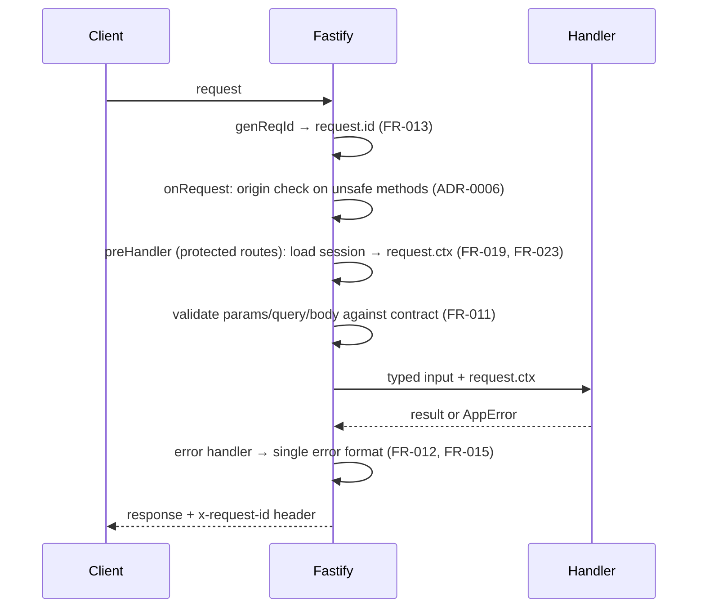

# Plan 000 — Foundation

| | |
|---|---|
| **Spec** | [`spec.md`](spec.md) (approved 2026-11-22) |
| **Status** | ✅ Approved (2026-11-22) |
| **ADRs** | [0001](../../adr/0001-modular-monolith.md) · [0002](../../adr/0002-api-module-boundaries.md) · [0003](../../adr/0003-authentication-own-sessions.md) · [0004](../../adr/0004-internal-packages-and-typescript-execution.md) · [0005](../../adr/0005-tenant-isolation.md) · [0006](../../adr/0006-web-api-topology.md) |
| **Next** | [`tasks.md`](tasks.md) |

> This document describes **how** the spec is implemented. Every section points to the requirements it serves. Decisions with real alternatives live in ADRs. Everything else is decided here in one line.

---

## 1. Summary

A pnpm + Turborepo monorepo with two applications and two shared packages:

- `apps/web`: Next.js. Only the interface. It talks to the API through a same-origin proxy.
- `apps/api`: Fastify. It has a small shared core (`platform/`) and three domain modules (`users`, `organizations`, `auth`) with enforced boundaries.
- `packages/contracts`: Zod schemas shared by web and API.
- `packages/tsconfig`: shared TypeScript settings.
- PostgreSQL 18 (with pgvector, ready for Phase 5) runs in Docker Compose.

The API runs TypeScript directly on Node 24 (type stripping), with no build step. Internal packages are consumed as source. Authentication is implemented in-house: server-side sessions in an `HttpOnly` cookie and argon2id passwords. Tenancy is enforced in the application layer through a mandatory `TenantContext`.

## 2. Technical context

Versions checked on 2026-11-22. They are pinned through the lockfile and the pnpm catalog (§12).

| Area | Choice | Version | Notes |
|---|---|---|---|
| Runtime | Node.js LTS | 24.x (`.nvmrc`: `24`) | Native TypeScript type stripping; still ships Corepack |
| Package manager | pnpm | 12.x (`packageManager` field) | Workspaces, `workspace:*`, catalogs |
| Task runner | Turborepo | 2.11 | Task graph + local cache |
| Language | TypeScript | 7.0 | Native compiler; fallback 6.0.x (see §15, R1) |
| Web | Next.js (App Router) + React | 16.4 / 19.3 | |
| Styling | Tailwind CSS + shadcn/ui | 4.3 | Tokens from product spec §2.12 as CSS variables |
| Remote state | TanStack Query | 5.x | |
| Forms | React Hook Form + `@hookform/resolvers` | 7.x | Reuses the contract schemas |
| API | Fastify | 5.12 | |
| Validation | Zod + `fastify-type-provider-zod` | 4.6 / 7.0 | |
| Cookies | `@fastify/cookie` | 11.x | |
| Database | PostgreSQL + pgvector | image `pgvector/pgvector:pg18` | `uuidv7()` built in since PG 18 |
| ORM / migrations | Drizzle ORM + drizzle-kit | 0.45 / 0.31 | Driver: `pg` (node-postgres) 8.x |
| Password hashing | `@node-rs/argon2` | 2.x | Prebuilt binaries, no `node-gyp` |
| Logs | Pino (built into Fastify) | 10.x | |
| Lint / format | Biome | 2.6 | |
| Boundaries | dependency-cruiser | 18.x | Enforces FR-009 / NFR-008 |
| Unit / integration tests | Vitest | 5.1 | |
| E2E / accessibility | Playwright + `@axe-core/playwright` | 1.65 / 4.14 | |
| CI | GitHub Actions | — | Q4 |

**One-line decisions** (alternatives exist, but none matters enough for an ADR):
- **Biome instead of ESLint + Prettier:** one fast tool. We lose the typescript-eslint rules that use type information; `noFloatingPromises` from Biome covers the most important one.
- **`pg` instead of `postgres.js`:** the most widely used driver, with the most documentation and support in other tools.
- **Postgres `uuidv7()` for primary keys:** time-ordered IDs are friendlier to indexes than random UUIDs, and the database generates them.
- **No Zustand, no `packages/ui` in Phase 0:** nothing needs them yet (progressive complexity).

## 3. Repository layout

```text
relay/
├── apps/
│   ├── api/
│   │   ├── src/
│   │   │   ├── server.ts               # entrypoint: env → buildApp → listen
│   │   │   ├── app.ts                  # buildApp(): plugins, hooks, routes (used by tests too)
│   │   │   ├── env.ts                  # configuration schema (FR-005)
│   │   │   ├── platform/               # shared core, not a domain module
│   │   │   │   ├── db.ts               # pool, Drizzle instance, Db/Tx types
│   │   │   │   ├── errors.ts           # AppError + error handler (FR-012, FR-015)
│   │   │   │   ├── tenant-context.ts   # TenantContext type (ADR-0005)
│   │   │   │   ├── origin-check.ts     # CSRF guard (ADR-0006)
│   │   │   │   └── logger.ts           # Pino options + redaction (FR-014)
│   │   │   └── modules/
│   │   │       ├── health/             # routes only
│   │   │       ├── users/              # schema, repository, service, index
│   │   │       ├── organizations/      # schema, repository, service, routes, index
│   │   │       └── auth/               # schema, repository, service, routes, plugin, index
│   │   ├── drizzle/                    # generated SQL migrations (versioned, FR-004)
│   │   ├── scripts/                    # migrate.ts, reset.ts
│   │   ├── test/                       # integration tests + helpers
│   │   ├── drizzle.config.ts
│   │   ├── .dependency-cruiser.cjs     # boundary rules (NFR-008)
│   │   └── .env.example
│   └── web/
│       ├── app/
│       │   ├── (auth)/sign-in, sign-up
│       │   └── (app)/layout.tsx, page.tsx (Home), settings/, settings/general/
│       ├── components/                 # shell (sidebar, account menu), ui/ (shadcn)
│       ├── lib/                        # api client, query client
│       ├── e2e/                        # Playwright specs
│       ├── proxy.ts                    # optimistic redirect when there is no session cookie
│       ├── next.config.ts              # rewrites /api/* → API (ADR-0006)
│       └── .env.example
├── packages/
│   ├── contracts/src/                  # common/, health/, auth/, me/, organizations/
│   └── tsconfig/                       # base.json, node.json, next.json
├── scripts/bootstrap.ts                # NFR-001
├── .github/workflows/ci.yml
├── docker-compose.yml
├── biome.json
├── pnpm-workspace.yaml                 # workspaces + catalog
├── turbo.json
├── package.json
├── .nvmrc
└── README.md                           # FR-032
```

**Deviation from product spec §8:** that section, which is explicitly a suggestion, lists `packages/database`. Here each module owns its tables inside `apps/api` instead (ADR-0002). A single shared schema package would let any module query any table, and FR-009 forbids that.

---

## 4. Architecture

### 4.1 Topology (ADR-0006)

```text
Browser ──▶ Next.js :3000 ──rewrite /api/* ──▶ Fastify :3001 ──▶ PostgreSQL :5432
            (pages + proxy)                     (all rules)
```

- The browser only ever talks to the web origin. `/api/v1/...` is rewritten to the API, so the session cookie is first-party and no CORS is needed.
- Next.js holds no domain logic. Pages fetch on the client with TanStack Query through `/api`.
- `proxy.ts` (the Next 16 name for middleware) only checks whether the session cookie *exists*, so it can redirect early (FR-027). The real check is always done by the API.

### 4.2 Inside the API (ADR-0002)

```text
            ┌──────────┐
routes ──▶  │   auth   │ ──▶ organizations ──▶ users
            └──────────┘
                 │               │               │
                 └──────── platform/ (db, errors, tenant-context, logger) ────────┘
```

- **Dependencies point one way:** `auth → organizations → users`. No cycles.
- **Each module has the same shape:** `schema.ts` (tables) · `repository.ts` (queries) · `service.ts` (rules) · `routes.ts` (HTTP) · `index.ts` (**the only public entry point**).
- **Rules enforced by dependency-cruiser** (part of the `lint` task):
  1. Code outside a module may only import that module's `index.ts`.
  2. **The one exception:** a module's `schema.ts` may import another module's `schema.ts`, and only to declare foreign keys.
  3. Modules may import `platform/`. `platform/` may not import modules.
  4. Module dependencies follow the graph above. Anything else is a violation, including cycles.
  5. `packages/*` never import `apps/*`. `packages/contracts` imports only `zod`.
- **Transactions across modules:** service functions take an optional `db: Db | Tx`. The use case that needs atomicity (sign-up) opens the transaction and passes it down. The modules stay independent, and the transaction stays explicit.

### 4.3 Request lifecycle



---

## 5. Data model

All tables use `uuid` primary keys with `DEFAULT uuidv7()`, and `timestamptz` timestamps (`created_at`, `updated_at` where rows change).

| Module | Table | Columns | Constraints |
|---|---|---|---|
| users | `users` | `id`, `name` (1–100), `email` (stored trimmed + lowercased), `created_at`, `updated_at` | `UNIQUE(email)` |
| organizations | `organizations` | `id`, `name` (1–80), `created_at`, `updated_at` | |
| organizations | `memberships` | `organization_id` → organizations, `user_id` → users, `created_at` | `PK(organization_id, user_id)`, index on `user_id` |
| auth | `password_credentials` | `user_id` (PK) → users, `password_hash`, `updated_at` | |
| auth | `sessions` | `id` (text, SHA-256 hex of the token), `user_id` → users, `active_organization_id` → organizations, `expires_at`, `created_at` | index on `user_id`; FKs `ON DELETE CASCADE` |

- **Credentials have their own table, apart from users:** a user is an identity; a password is one way of proving it. OAuth (later) adds another credential type without touching `users`.
- **FR-024:** `memberships` already allows many organizations per user. Phase 0 just never creates a second one.
- **No `role` column yet:** roles are P1 (spec §8). The column will be added by the phase that needs it.
- **Migrations:** `drizzle-kit generate` produces SQL files in `apps/api/drizzle/`, and those files are committed and reviewed. `pnpm db:migrate` applies them with Drizzle's programmatic migrator, which tests and CI use too.

## 6. API contract

All business routes are under `/v1`. Request and response schemas live in `packages/contracts` (FR-008). Every object schema is `z.strictObject`, so unknown fields are rejected (FR-011).

| Method | Path | Auth | Body | Success | Errors |
|---|---|---|---|---|---|
| GET | `/health/live` | — | — | `200 {status:"ok"}` | — |
| GET | `/health/ready` | — | — | `200 {status:"ok"}` | `503 NOT_READY` |
| POST | `/v1/auth/sign-up` | — | `{name, email, password}` | `201 Me` + `Set-Cookie` | `400 VALIDATION_FAILED`, `409 EMAIL_TAKEN` |
| POST | `/v1/auth/sign-in` | — | `{email, password}` | `200 Me` + `Set-Cookie` | `400`, `401 INVALID_CREDENTIALS` |
| POST | `/v1/auth/sign-out` | session | — | `204` + cookie cleared | `401 UNAUTHENTICATED` |
| GET | `/v1/me` | session | — | `200 Me` | `401` |
| GET | `/v1/organizations/:organizationId` | session | — | `200 Organization` | `401`, `404 NOT_FOUND` |
| PATCH | `/v1/organizations/:organizationId` | session | `{name}` | `200 Organization` | `400`, `401`, `404` |

`Me = { user: {id, name, email}, organization: {id, name} }`

**Error format** (FR-012), defined once in `contracts/common`:

```json
{
  "error": {
    "code": "VALIDATION_FAILED",
    "message": "Request validation failed.",
    "details": [{ "path": "body.nickname", "message": "Unrecognized key" }],
    "requestId": "01JD…"
  }
}
```

- **Codes:** `VALIDATION_FAILED` 400 · `UNAUTHENTICATED` 401 · `INVALID_CREDENTIALS` 401 · `FORBIDDEN_ORIGIN` 403 · `NOT_FOUND` 404 · `EMAIL_TAKEN` 409 · `NOT_READY` 503 · `INTERNAL` 500.
- **Unknown routes** go through `setNotFoundHandler` and use the same format.
- **The error handler** maps the type provider's Zod errors to `VALIDATION_FAILED` and `AppError` subclasses to their own code. Anything else is logged with its stack and returned as a generic `INTERNAL` (FR-015).

## 7. Authentication and sessions (ADR-0003)

- **Password rules (FR-016):** 15–128 characters, no composition rules. This follows NIST SP 800-63B rev. 4 for passwords used as a single factor. Checking passwords against a breached-password list is deferred to Phase 9.
- **Hashing (NFR-002):** argon2id with OWASP's minimum parameters (m = 19 MiB, t = 2, p = 1), set in one constant.
- **Sign-up (FR-016, FR-017):** one transaction creates the user, the credential, the organization named `"{first name}'s workspace"`, the membership and the session.
- **Sign-in (FR-018):** if the email does not exist, the API still verifies the password against a fixed dummy hash. That way both failures take the same time and return the same `INVALID_CREDENTIALS`.
- **Session token:** 32 random bytes encoded as base64url, sent to the client **only** in the cookie. The database stores `SHA-256(token)` as `sessions.id`, so a leaked database does not leak usable sessions.
- **Cookie:** `relay_session`, `HttpOnly`, `SameSite=Lax`, `Path=/`, `Secure` when `COOKIE_SECURE=true` (production), `Max-Age` 7 days.
- **Validation and renewal (FR-019, Q5):** on every authenticated request:
  - If the session is missing or `expires_at` is in the past, the request gets `401`, and an expired row is deleted.
  - Otherwise the API sets `expires_at = now() + 7 days` and sends the cookie again.
  - This costs one write per request, which is fine at this scale. Throttling it would change the spec's "7 days without use" rule, so it would need a spec change first.
- **Sign-out (FR-020, AC-16):** deletes the session row and clears the cookie. Any copy of the token stops working at once.
- **Accepted risk (AC-14):** sign-up necessarily reveals that an email is taken. Rate limiting arrives in Phase 9.

## 8. Tenancy (ADR-0005)

- `TenantContext = { userId, organizationId }` is a branded type. The only code that builds it is the auth `preHandler`, from the session's `active_organization_id`, and it attaches it to `request.ctx`.
- Every repository function that touches business data takes `ctx: TenantContext` as its **first parameter** and filters by `ctx.organizationId`. Without a context the code does not compile (FR-025).
- For `/v1/organizations/:organizationId`: if `organizationId !== ctx.organizationId`, the API throws `NOT_FOUND` without querying (FR-026). Otherwise the query also filters by the context.
- `users` and `organizations` themselves are not "business data inside an org". Their repositories take explicit IDs and are reachable only through module services. The boundary rules forbid going around them.
- **Proof (NFR-003, AC-19):** integration tests with two organizations try every cross-tenant read and write.

## 9. Request IDs, logging and health

- **Request ID (FR-013):** `genReqId` generates a UUID per request; an incoming header is never trusted. An `onSend` hook sets `x-request-id`. Fastify already adds `reqId` to every log line of the request.
- **Redaction (FR-014):** Pino `redact` covers `req.headers.cookie`, `req.headers.authorization`, `res.headers["set-cookie"]`, `*.password` and `*.token`. Request bodies are never logged.
- **Format:** JSON logs. `pino-pretty` is used only when `LOG_PRETTY=true` (dev).
- **Health (FR-010):** `live` touches nothing external. `ready` runs `SELECT 1` with a 1 s timeout and answers `503 NOT_READY` on failure.

## 10. Configuration (FR-005, FR-006)

- Each app has `src/env.ts`: a Zod schema parsed at startup. On failure it prints every invalid or missing variable by name and exits with code 1.
- Files are loaded with Node's `--env-file-if-exists=.env`, so `dotenv` is not needed. Next.js loads its own `.env` files natively.
- **API variables:** `DATABASE_URL`, `PORT` (3001), `WEB_ORIGIN` (`http://localhost:3000`), `COOKIE_SECURE` (false), `LOG_LEVEL` (info), `LOG_PRETTY` (false).
- **Web variables:** `API_URL` (`http://localhost:3001`), used only server-side by the rewrite.
- `.env.example` files contain only local development values. `.env` is in `.gitignore` (NFR-004).

## 11. Web app

- **Routes:**
  - `(auth)`: `/sign-in`, `/sign-up`.
  - `(app)`: `/` (Home), `/settings` (grouped list with General only), `/settings/general`.
- **Session gate:**
  - `proxy.ts` redirects requests without the cookie to `/sign-in?next=<path>`.
  - The `(app)` layout loads `/v1/me` and redirects on `401`.
  - `next` is accepted only if it starts with `/` and not `//`, so it cannot become an open redirect (FR-027).
- **Shell (FR-028, FR-029):**
  - The sidebar shows the workspace name, Home and the account menu (Settings, Sign out). No entries for unbuilt modules.
  - Home shows the empty state from product spec §2.12 (FR-031).
- **Design tokens (FR-030):** Tailwind v4 `@theme` maps the §2.12 tokens to CSS variables. Fonts are Geist and Geist Mono through `next/font`. Only the shadcn components that are needed are added: Button, Input, Label, DropdownMenu.
- **Forms:** React Hook Form with the contract schemas. API `VALIDATION_FAILED` details are mapped back to fields, with `aria-describedby` linking each error to its field (NFR-007).
- **Accessibility (NFR-007):** landmarks (`nav`, `main`), `aria-current="page"`, visible focus ring and 34px minimum targets.

## 12. Developer environment and commands

**Prerequisites:** Node 24, pnpm 12 (or Corepack), Docker with Compose v2.

| Command | What it does | Requirement |
|---|---|---|
| `pnpm install` | Installs everything | FR-001 |
| `pnpm bootstrap` | Copies the `.env.example` files where `.env` is missing, runs `docker compose up -d --wait` and applies migrations | FR-001, NFR-001 |
| `pnpm dev` | `turbo run dev`: web on :3000, API on :3001, both with watch | FR-002, NFR-006 |
| `pnpm check` | `turbo run typecheck lint test` | FR-003 |
| `pnpm test:e2e` | Playwright against running apps | AC-13, 17, 18, 20, 21 |
| `pnpm db:generate` / `db:migrate` / `db:reset` | Generate a migration / apply / drop and re-migrate | FR-004 |

**NFR-001:** a clean clone needs exactly three commands: `pnpm install && pnpm bootstrap && pnpm dev`.

`db:reset` refuses to run unless `DATABASE_URL` points to `localhost` or `127.0.0.1`.

**Docker Compose:** one `postgres` service (`pgvector/pgvector:pg18`) with a healthcheck, a named volume, the port from `POSTGRES_PORT` (default 5432) and an init script that also creates `relay_test`.

**Turborepo (`turbo.json`):**
- `dev` is `persistent` with `cache: false`.
- `typecheck`, `lint` and `test` are cached, with explicit `inputs`.
- Because internal packages are not built (ADR-0004), dependents would not see a dependency's changes in their cache hash. A no-op `transit` task with `dependsOn: ["^transit"]` fixes that: `typecheck`, `lint` and `test` depend on `transit`, so a change in `contracts` re-runs its dependents and nothing else (AC-02, AC-03).

**pnpm catalog:** every external version used by more than one package (zod, typescript, vitest…) is declared once in `pnpm-workspace.yaml`. Packages use `catalog:`.

## 13. Testing strategy

| Level | Tool | Where | Covers |
|---|---|---|---|
| Unit | Vitest | `packages/contracts`, `apps/api/src/**` | Schemas, env parsing (AC-05), error mapping, password policy |
| API integration | Vitest + `app.inject()` + real Postgres (`relay_test`) | `apps/api/test/` | AC-08–AC-19 |
| E2E + a11y | Playwright + axe | `apps/web/e2e/` | AC-13, AC-17 (web), AC-18, AC-20, AC-21 |
| Boundaries | dependency-cruiser | `apps/api` lint | AC-07 |
| Demonstrated during Verify | scripted or manual, recorded in `spec.md` §10 | — | AC-01–04, AC-06, AC-22 |

- **Integration tests:**
  - A global setup migrates `relay_test`.
  - Each test truncates all tables (`TRUNCATE … CASCADE`).
  - API test files run serially (`fileParallelism: false`). That is simple and fast enough for now.
  - Testcontainers was considered and rejected: Compose already provides the database.
- **AC-08 (database down):** build the app with a pool pointed at a closed port.
- **AC-11 (no secrets in logs):** build the app with a Pino destination that captures lines in memory, then assert that neither the password nor the token appears.
- **AC-12 (unexpected error):** a test-only route registered through a `buildApp` option throws on purpose.

## 14. CI (NFR-005)

`.github/workflows/ci.yml` runs on every push and pull request:
1. **Setup:** checkout, Node 24 via `.nvmrc`, pnpm via `packageManager`, pnpm store cache.
2. **Database:** a Postgres service container (same image).
3. **Checks:** `pnpm install --frozen-lockfile`, migrations against `relay_test`, then `pnpm check`.
4. **E2E:** Playwright (Chromium only) against apps started in the job.
5. **Turbo cache:** `.turbo` is cached between runs with `actions/cache`. No remote cache.

## 15. Risks

| # | Risk | Mitigation |
|---|---|---|
| R1 | TypeScript 7 (native compiler) breaks a tool that relies on the TS JavaScript API (e.g. the type check inside `next build`) | The first task is a spike: create the skeleton and run `typecheck` and `next build`. If anything fails, pin TypeScript 6.0.x in the catalog and note it in ADR-0004 |
| R2 | Node type stripping does not handle something we need (non-erasable syntax, `.ts` import extensions in Next) | `erasableSyntaxOnly` and `verbatimModuleSyntax` in the base tsconfig catch it at compile time. The R1 spike also covers Next resolving `.ts` imports. Fallback: `tsx` in the API (ADR-0004) |
| R3 | Security bugs in hand-written auth | Small surface (4 endpoints); OWASP Session Management and Password Storage cheat sheets as checklists; integration tests for every AC; ADR-0003 records when to move to a library |
| R4 | Port conflicts (5432, 3000, 3001) on the developer machine | All ports come from configuration with documented defaults |
| R5 | One DB write per authenticated request for session renewal | Fine at this scale. Revisiting it requires a spec change (see §7) |

## 16. Traceability

| Requirement | Plan section |
|---|---|
| FR-001–002, NFR-001, NFR-006 | §12 |
| FR-003, AC-02/03 | §12 (Turborepo) |
| FR-004 | §5, §12 |
| FR-005–006, NFR-004 | §10 |
| FR-007 | §3, ADR-0004 |
| FR-008 | §6 |
| FR-009, NFR-008 | §4.2, ADR-0002 |
| FR-010, FR-013–015 | §9, §6 |
| FR-011–012 | §6 |
| FR-016–023, NFR-002 | §7, ADR-0003 |
| FR-024–026, NFR-003 | §8, ADR-0005 |
| FR-027–031, NFR-007 | §11 |
| FR-032–033 | README, `docs/adr/` |
| NFR-005 | §14 |

## 17. Spec changes made while planning

- **FR-016:** sign-up also asks for a **name**. FR-017 derives the organization name from the user, and the design's account menu shows the user's name ("Ana Moreira"). Without a name, FR-017 would have nothing sensible to derive from. The spec was updated first, as the README requires.
